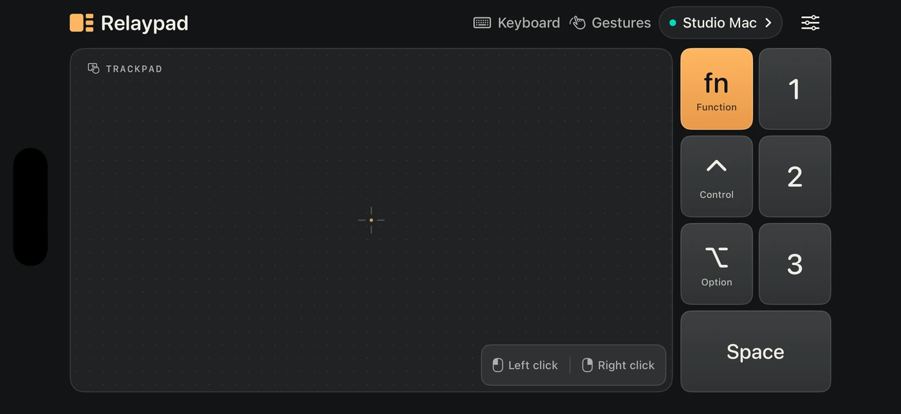

# Relaypad

Use your iPhone as a wireless Mac trackpad with seven customizable shortcut keys. In landscape, about 80% of the control surface moves the pointer. The right side holds Fn, Control, Option, 1, 2, 3, and a wide Space bar. Both apps run natively and pair over your local network.

[Get Relaypad](https://chheplo.github.io/relaypad/#downloads) · [GitHub releases](https://github.com/chheplo/relaypad/releases) · [Mac receiver screenshot](release-assets/web/mac-receiver.webp) · [Shortcut settings screenshot](release-assets/web/iphone-shortcuts.webp)

## Install

You need an iPhone running iOS 17 or later and a Mac running macOS 14 or later. The downloads page lists availability for the iPhone app and for Apple silicon and Intel Mac receivers. For a published Mac disk image, open the matching DMG and drag **Relaypad for Mac** to Applications. You can also build either app directly from this checkout. [Downloads](https://chheplo.github.io/relaypad/#downloads) · [Build from source](CONTRIBUTING.md#build-from-source)

## Pair and try it

1. Put both devices on the same local network. On the Mac, open **Relaypad for Mac** and click **Start receiver**.
2. Click **Allow access** and enable the running copy of Relaypad for Mac in **System Settings → Privacy & Security → Accessibility**. Allow Local Network access on either device if prompted.
3. On the iPhone tap **Pair Mac**, select the computer and enter its 12-character pairing code. Relaypad remembers the receiver. You can unplug a phone installed through Xcode.
4. Open an empty TextEdit document on the Mac. Slide a finger to move the pointer, tap the pad to click inside the document, then press **1**, **2**, **3**, **Space**. The same controls now work in the Mac app you focus.

## Controls

| On the iPhone | On the Mac |
| --- | --- |
| Slide one finger | Move the pointer |
| Tap the pad once or twice | Click or double-click |
| Tap **Left click** or **Right click** | Click the selected button |
| Slide two fingers | Scroll horizontally or vertically |
| Hold one finger still, then move it | Drag until you lift |
| Hold a modifier and tap another key | Send a key combination |
| Tap **Keyboard**, type or dictate with the iPhone keyboard, then tap **Send** | Insert text into the focused field |

Open the sliders button to remap a key, assign a named shortcut, adjust pointer speed or turn haptics off. Mappings persist across launches. **Gestures** shows the controls on the phone.

### Shortcuts for voice coding

- **Wispr Flow on Mac** supports a quick double-tap of its push-to-talk shortcut and a separate hands-free binding. When Fn is your push-to-talk key, tap it twice within half a second, or try Relaypad’s Fn+Space preset. Flow uses the microphone selected on the Mac. Test start and stop with your installed version, since apps handle synthetic Fn events differently. [Wispr Flow hands-free guide](https://docs.wisprflow.ai/articles/6391241694-use-flow-hands-free)
- **Codex desktop** presets include Command+N for a new chat, Command+K for the command menu, and Control+Shift+V for voice when available. Return and Escape are available as individual mappings. [OpenAI keyboard shortcuts](https://learn.chatgpt.com/docs/reference/commands)
- **Claude Code** presets include Control+C to interrupt and Shift+Tab to cycle permission modes. Their effect depends on what the focused terminal is doing. [Anthropic interactive mode](https://code.claude.com/docs/en/interactive-mode)

## Privacy and pairing

The Mac advertises its service name and a receiver ID through Bonjour. The phone authenticates with the pairing code and sends pointer movements, keyboard events and submitted text directly to the receiver over TLS. Anyone on the local link who knows the code can use it. The Mac accepts one phone at a time. Choose **New code** on the Mac to revoke previous pairings, or **Stop receiver** to close the listener. The apps store saved secrets in Keychain. [Privacy](https://chheplo.github.io/relaypad/privacy.html)

## Compatibility and support

The iPhone and Mac ship independently. Versions that speak protocol v1 can pair even when their app version numbers differ. The seven-key layout uses the same wire messages as the earlier six-key deck. [Protocol v1](docs/protocol-v1.md)

If the Mac is missing from **Pair Mac**, check Wi-Fi, Local Network permission and the receiver’s Start/Stop control. If the iPhone shows **Enable input**, grant Accessibility access to the copy of Relaypad currently running. Start the receiver again after Mac sleep or a user switch. [Support](https://chheplo.github.io/relaypad/support.html) · [Contributing and checks](CONTRIBUTING.md) · [MIT license](LICENSE)
